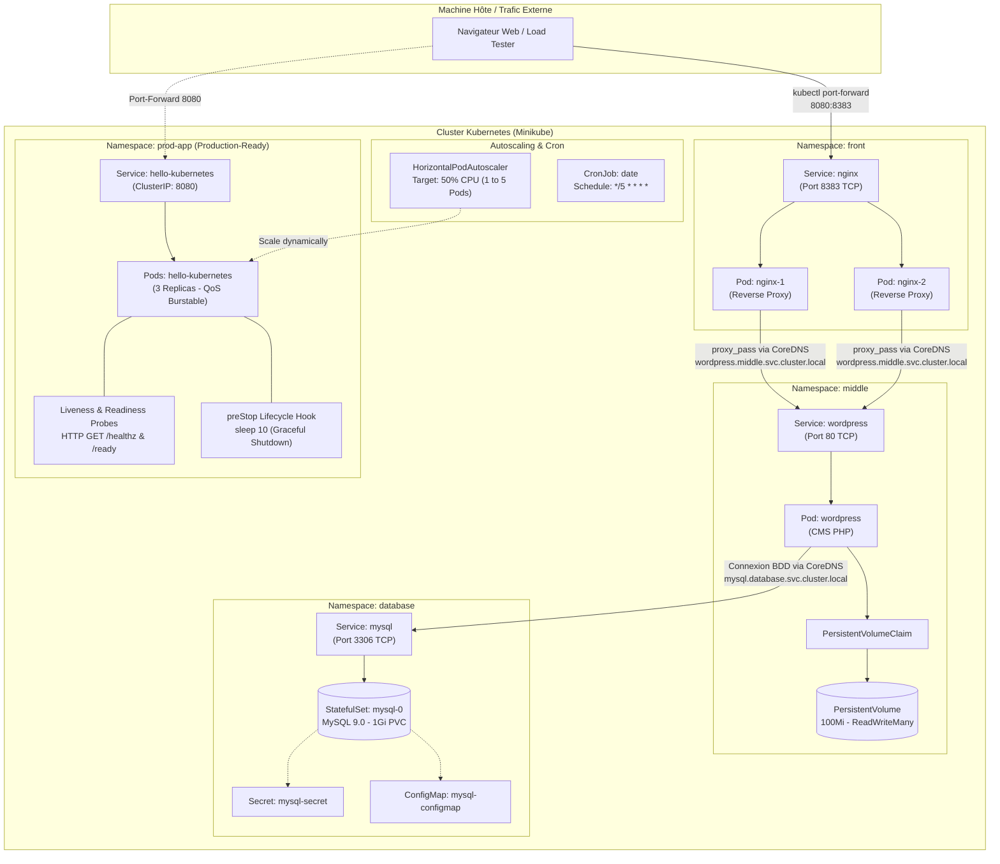
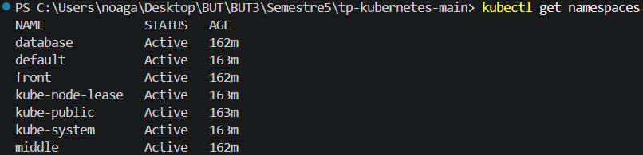
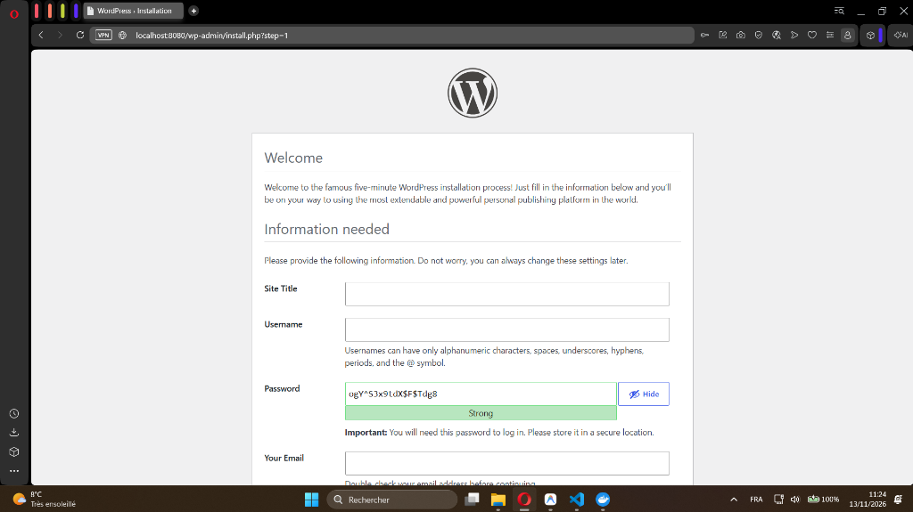
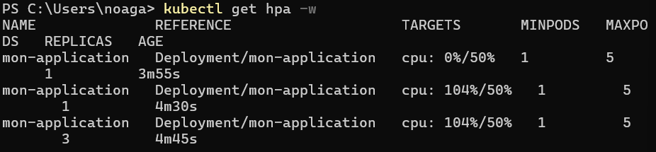
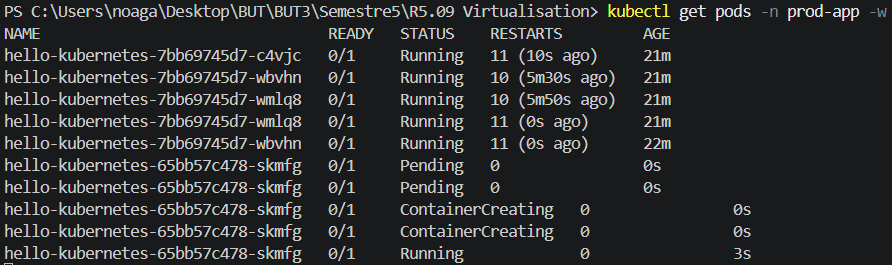
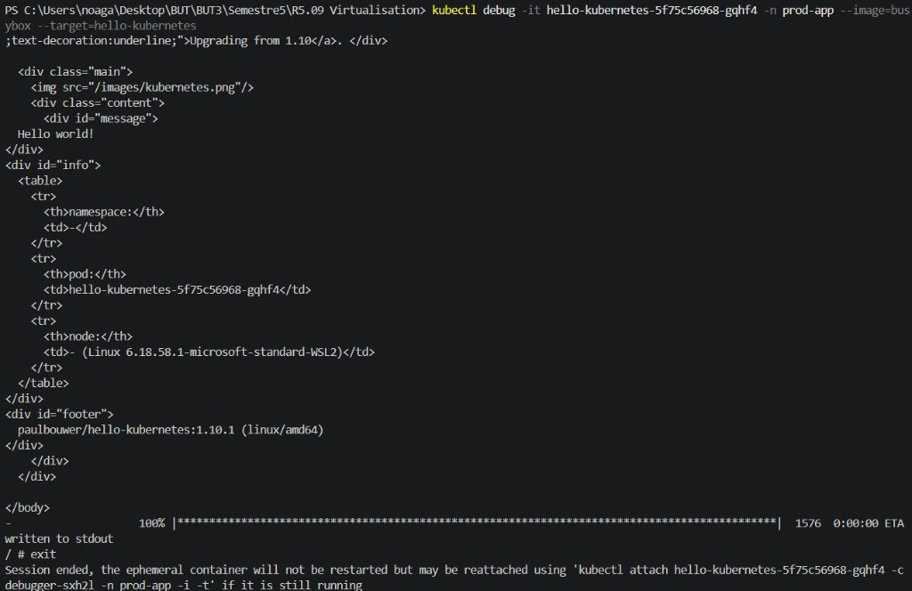

# ☸️ Kubernetes Multi-Tier Architecture & Production-Ready Platform

[](https://kubernetes.io/)
[](https://minikube.sigs.k8s.io/)
[](https://www.docker.com/)
[](https://nginx.org/)
[](https://www.mysql.com/)
[](https://wordpress.org/)

Plateforme orchestrée sur **Kubernetes** mettant en œuvre le déploiement d'une application web multi-tiers isolée par des **Namespaces**, avec persistance dynamique via **StatefulSet**, équilibrage de charge, autoscaling horizontal (**HPA**), sondes de santé de niveau production et conteneurs de débogage éphémères.

---

## 🎯 Architecture Globale & Flux Réseau



---

## 🛠️ Stack Technique

| Composant | Technologie | Rôle dans l'Architecture |
| :--- | :--- | :--- |
| **Orchestrateur** | Kubernetes v1.37 / Minikube v1.39 | Planification des conteneurs, gestion du cycle de vie et réseau CNI |
| **Runtime Conteneurs** | Docker Desktop / containerd | Exécution et isolation des conteneurs applicatifs |
| **Couche Entrée (Front)** | NGINX 1.27.1 Alpine (2 replicas) | Reverse-proxy HTTP, terminaison de trafic et routage inter-namespaces |
| **Couche Métier (Middle)** | WordPress Latest (CMS) | Traitement applicatif connecté via CoreDNS |
| **Couche Données (Database)** | MySQL 9.0 StatefulSet | Persistance des données relationnelles, volumes dédiés et secrets chiffrés |
| **Autoscaling & Tâches** | Kubernetes HPA (v2) & CronJob | Mise à l'échelle automatique selon la charge CPU et batchs planifiés |
| **Résilience Production** | Liveness, Readiness, preStop | Tolérance aux pannes, zéro downtime en RollingUpdate et arrêt gracieux |

---

## 🚀 Guide de Démarrage Rapide

### 1. Démarrer le cluster local
```bash
minikube start --driver=docker
minikube addons enable metrics-server
```

### 2. Déployer l'architecture multi-tiers
```bash
# Namespaces
kubectl apply -f TP/front/namespace.yml
kubectl apply -f TP/middle/namespace.yml
kubectl apply -f TP/database/namespace.yml

# Database (MySQL StatefulSet)
kubectl apply -f TP/database/mysql-secret.yml -n database
kubectl apply -f TP/database/mysql-configmap.yml -n database
kubectl apply -f TP/database/mysql-service.yml -n database
kubectl apply -f TP/database/mysql-statefulset.yml -n database

# Middle (WordPress CMS)
kubectl apply -f TP/database/mysql-secret.yml -n middle
kubectl apply -f TP/database/mysql-configmap.yml -n middle
kubectl apply -f TP/middle/wordpress-pv.yml
kubectl apply -f TP/middle/wordpress-pvc.yml -n middle
kubectl apply -f TP/middle/wordpress-service.yml -n middle
kubectl apply -f TP/middle/wordpress-deployment.yml -n middle

# Front (NGINX Reverse Proxy)
kubectl apply -f TP/front/nginx-cm.yml -n front
kubectl apply -f TP/front/nginx-deployment.yml -n front
kubectl apply -f TP/front/nginx-service.yml -n front
```

### 3. Accéder à l'application web
```bash
kubectl port-forward -n front svc/nginx 8080:8383
```
Puis ouvrez votre navigateur sur `http://localhost:8080`.

---

## 📊 Principales Réalisations & Éléments Techniques

### 1. Cloisonnement Réseau & Namespaces
* Séparation stricte des couches en 3 namespaces : `front`, `middle`, `database`.
* Découverte de services inter-namespaces par le DNS interne du cluster (CoreDNS) :
  * WordPress cible la BDD via `mysql.database.svc.cluster.local:3306`.
  * NGINX achemine le trafic vers le CMS via `wordpress.middle.svc.cluster.local:80`.

### 2. Persistance & StatefulSets
* Utilisation d'un **StatefulSet** pour MySQL afin de garantir l'unicité du pod (`mysql-0`), la stabilité du stockage et l'ordonnancement de démarrage.
* Découplage de la configuration applicative (`ConfigMap`) et des identifiants sensibles (`Secret` encodé base64).

### 3. Autoscaling Horizontal (HPA)
* Monitoring temps réel via l'addon `metrics-server`.
* Déclenchement automatique de réplicas supplémentaires (de 1 à 3+ pods) dès que la consommation CPU dépasse le seuil cible de 50%.

### 4. Standards de Résilience "Production-Ready"
* **Qualité de Service (QoS) :** Définition stricte des `requests` et `limits` plaçant l'application en classe **Burstable** pour éviter toute éviction sauvage par l'OOMKiller.
* **Probes de santé :** 
  * `livenessProbe` sur `/healthz` pour redémarrer automatiquement les conteneurs bloqués en deadlock.
  * `readinessProbe` sur `/ready` pour retirer temporairement les pods lents de l'équilibrage de charge.
* **Déploiement sans coupure (RollingUpdate) :** Remplacement progressif des pods garantissant 100% de disponibilité des routes.
* **Arrêt gracieux (`preStop`) :** Temporisation avant `SIGTERM` permettant de drainer les requêtes HTTP et de fermer les transactions en cours.
* **Débogage minimaliste (`kubectl debug`) :** Intégration de conteneurs de diagnostic éphémères (`busybox`) sans alourdir ni affaiblir la sécurité des images de production.

---

## 📸 Aperçu du Cluster & Résultats Visuels

| Composant | Aperçu |
| :--- | :--- |
| **Front NGINX & Namespaces** |  |
| **Port-Forward WordPress** |  |
| **Autoscaling HPA en charge** |  |
| **RollingUpdate sans interruption** |  |
| **Débogage conteneur éphémère** |  |

---

## 👤 Auteur
* **Noa** ([@NewGamer62](https://github.com/NewGamer62)) - BUT Informatique
